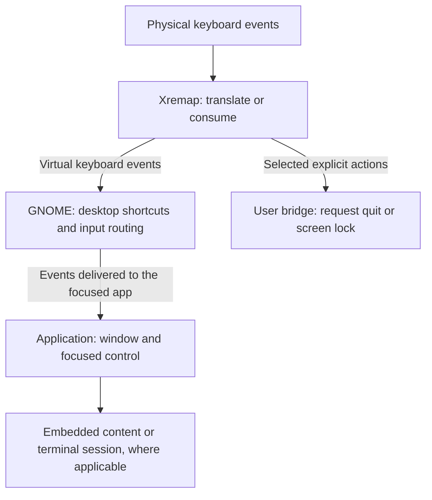

# Mental model

GNOME MacLike makes a small set of familiar keyboard habits work on Ubuntu.
We accept deliberate shortcut conflicts in exchange for consistency. We do not
try to reproduce every macOS shortcut or preserve every application's original
bindings. The important question is whether the resulting desktop is predictable,
usable and reversible.

This document distinguishes our compatibility policy from what the current code
actually does. It does not certify every application or keyboard layout.
See [Shortcut selection and coverage](SHORTCUTS.md) for the research, priorities
and status definitions used by the app's searchable shortcut inventory.

## Precedence is real, but there are more than two levels

“The desktop gets first refusal, then the focused application” is a useful default
for ordinary desktop shortcuts. When the desktop consumes a shortcut, the app
normally cannot also use that combination for its own action. A global shortcut
registered by an application can participate in desktop-level handling too; its
owner need not be the operating system itself.

There is no universal, fixed two-level hierarchy across operating systems.
Applications have their own routing among windows, menus, focused controls and
embedded content. For example, GTK checks window shortcuts and propagates events
through widgets, any of which can consume an event. A text field and the rest of
the application need not interpret the same keys identically.
[GTK input handling](https://docs.gtk.org/gtk4/input-handling.html)

Remote desktops, virtual machines and other applications may also request that
the compositor yield some shortcuts. Wayland defines a protocol for this, but the
compositor can retain an escape combination. This is an exception to the normal
routing, not a promise that an application can take over every shortcut.
[Wayland protocol source, reproduced in SDL](https://skia.googlesource.com/third_party/sdl/+/refs/heads/master/wayland-protocols/keyboard-shortcuts-inhibit-unstable-v1.xml)

For our supported Ubuntu GNOME Wayland session, the useful model is:

This is a routing model, not a complete diagram of drivers, keyboard layouts,
input methods or operating-system security boundaries. Xremap grabs the selected
input devices and supplies translated input before GNOME and ordinary apps act
on it. That placement is why we can change what a physical chord means. It does
not give us a portable guarantee of overriding every protected system action.
See the pinned [Xremap device handling](https://github.com/xremap/xremap/blob/v0.15.19/src/device.rs)
and our [runtime configuration](runtime.py).

## Physical keys, logical modifiers and actions are different things

“Command” is the role we assign to a key, not the modifier that Linux applications
necessarily receive. On a PC keyboard, our Command key is left Alt; on an Apple
keyboard it is left Super. The base behavior holds a real Linux Control modifier.

That means ordinary Command+C, Command+T and Command-click use the application's
existing Control behavior. We do not need individual copy, new-tab or mouse-click
patches. “Acts like Command” is a user convention implemented using Linux's own
conventions; it is not a new universal modifier understood by every app.

Our optional layers add a few exceptions:

| User action | Current translation or request | Final owner |
| --- | --- | --- |
| Command+C in an ordinary app | Control+C | Focused app/control |
| Command-click | Hold Control while the click occurs | App's existing modified-click behavior |
| Command+C/V in a recognized standalone terminal | Control+Shift+C/V | Terminal emulator's clipboard shortcuts |
| Physical Control+C in a recognized terminal | Control+C | Terminal/session; normally interrupt under conventional terminal settings |
| Command+Tab | Release the generated Control; hold Super and send Tab | GNOME's native app switcher |
| Command+H | Temporarily release Control and send Super+H | GNOME's minimize binding |
| Command+Q | Request normal app quit through the bridge | GNOME/application, including any save confirmation |
| Control+Command+Q | Request screen lock through the bridge | GNOME's screen-lock service |
| Command/Option arrows | Home/End or Control-arrow combinations | Focused app/control |

The base swap, separate physical Control, terminal exceptions, desktop actions
and navigation are bounded switches compiled into one Xremap configuration.
They are not an arbitrary stack of plugins. Disabling the Command layer removes
its dependent mappings; emergency stop remains available.
Implementation: [profiles.py](profiles.py), [config.json](config.json),
[pc.json](pc.json), [apple.json](apple.json), [bridge.py](bridge.py).

## A remap has two possible conflicts

Check both the physical chord we replace and the translated chord we emit.

If we consume a physical chord before GNOME sees it, its previous desktop action
can lose that shortcut. That can be an intentional product choice. But GNOME
still gets first refusal on the **translated** chord: emitting a combination
that GNOME consumes will not magically deliver it to the application.

Likewise, mapping a chord to a global desktop action makes any app action on that
physical chord unavailable while the mapping applies. We accept this for our
small documented set. We should reserve only the combinations we actually need,
not an entire modifier namespace for hypothetical future features.

Current GNOME MacLike does **not** rewrite GNOME's keyboard bindings. It translates
input into existing bindings or calls a specific desktop action. If a user
customizes the destination binding, our translation may stop producing the
intended result. Deliberately changing a native binding is a possible future
choice, but would require recording and restoring its previous value.

For example, Command+backtick is a candidate for GNOME's existing same-app window
switcher, which normally uses Super plus the key above Tab. This would reuse a
desktop action, not require a Chrome-specific window-cycling implementation.
**That Command mapping is proposed, not implemented by this document.**
[GNOME shortcut reference](https://help.gnome.org/gnome-help/shell-keyboard-shortcuts.html)

## Which breakage is acceptable?

Our priority compatibility targets are Chrome/Chromium, supported standalone
terminals, and GNOME Files. They cover browsing, command-line work and file
management. Compatibility means their everyday workflows remain coherent; it
does not mean every obscure shortcut in those apps must survive.

| Outcome | Policy |
| --- | --- |
| A familiar shortcut replaces a nonessential Ubuntu shortcut | Accept deliberately; document what lost its binding and how the action remains accessible. |
| A less common app loses a conflicting convenience shortcut | Accept as a known limitation; prefer a layer toggle or opt-out over another special case. |
| Option-arrow navigation replaces browser Back/Forward shortcuts | Existing deliberate tradeoff; browser navigation remains available through its UI. |
| A shortcut unexpectedly quits, closes, deletes or pastes into the wrong place | Treat as a correctness problem, not harmless loss of convenience. |
| Ordinary typing, text entry, terminal interruption or a needed accessibility path becomes unusable | Protect these workflows; do not dismiss the issue as an obscure shortcut conflict. |
| A game, remote session or specialist editor depends on exact physical input | Use native input by stopping remapping when necessary; do not promise transparent compatibility. |
| Modifiers stick, actions repeat unexpectedly, or recovery is unavailable | Release-blocking behavior for the affected mapping. |

Many shortcuts are conveniences, but not all input has a practical mouse/menu
replacement. Terminal control, accessibility and keyboard-driven applications
make “no keyboard shortcut is critical” too broad. Our policy accepts bounded,
understood tradeoffs, not arbitrary effects because they began with a key press.

## Known boundaries in the current implementation

**Physical Control is not universally native.** With its layer enabled, it becomes
Super in ordinary applications so that Control+A/T do not duplicate Command+A/T.
It can therefore invoke desktop actions. In recognized standalone terminals it
stays Control. Disabling this layer preserves physical Control, but accepts the
duplicate application shortcuts. This is a product tradeoff, not full macOS
Control-key emulation.

**Terminal handling is a category exception.** The emulator handles clipboard
shortcuts before passing terminal input onward. Conventional Control+C can then
be interpreted as an interrupt by the terminal subsystem; programs using other
terminal modes can interpret it differently. Command-to-Control alone cannot
distinguish copying from interrupting. Our Shift exception supplies that distinction.

**We identify applications, not the focused widget.** An embedded terminal inside
a browser or editor follows its host application's mapping. It does not get the
standalone-terminal clipboard rule. Navigation mappings also apply outside text
fields, where the translated keys may have another meaning.

**An app exclusion is not full native input.** It disables optional desktop,
terminal and navigation shortcuts for that app. The base modifier mapping,
physical-Control rule and emergency stop remain. For a complete bypass, Stop the
remapper; the current GUI has no per-app full bypass.

**Missing desktop context is a real compatibility gap.** Physical Control falls
back to Control and app-sensitive exceptions stop applying, but the base Command
mapping remains. Command+C can therefore interrupt a terminal instead of copying
when its context is unavailable. The policy above does not excuse this behavior;
it is a documented limitation of the current fallback, not a solved problem.

**State matters as much as the chosen key.** Holding Command, repeating Tab,
adding Shift, changing focus and releasing keys must form a consistent sequence.
A correct-looking mapping can still fail through a stuck modifier or wrong
release order. Layouts, AltGr, input methods and custom destination bindings also
need explicit validation rather than assumptions from a US keyboard.

## How we decide whether to add a mapping

For each proposal, record the physical input, translated output or desktop
request, intended owner, applicable context/layer, displaced behavior and escape
route. Prefer the base modifier translation; next prefer an existing GNOME
action or a general application convention. Use a small category exception only
when it solves a recurring distinction, as terminals do.

If supporting a feature requires identifying individual websites, widgets or an
ever-growing list of application quirks, leave it unsupported or offer a bounded
opt-out. Our aim is a coherent default, not exhaustive emulation.

Validate forward/reverse cycling, held-key repeat and release, focus transitions,
typing after the shortcut, the priority apps, layer toggles and missing context
as applicable. Parser and unit tests check configuration and recovery; they do
not substitute for a live keyboard trial. Mark untested behavior honestly.

Physical Ctrl+Alt+Esc is the remapper's emergency stop. Stop releases the input
grabs; persistent managed changes use separate restoration records. The audit log
records configuration changes, not keystrokes. An accepted conflict must remain
explainable and reversible, with original values retained if we change settings.
See the [README's recovery and uninstall boundaries](README.md#audit-and-uninstall-guarantees).
